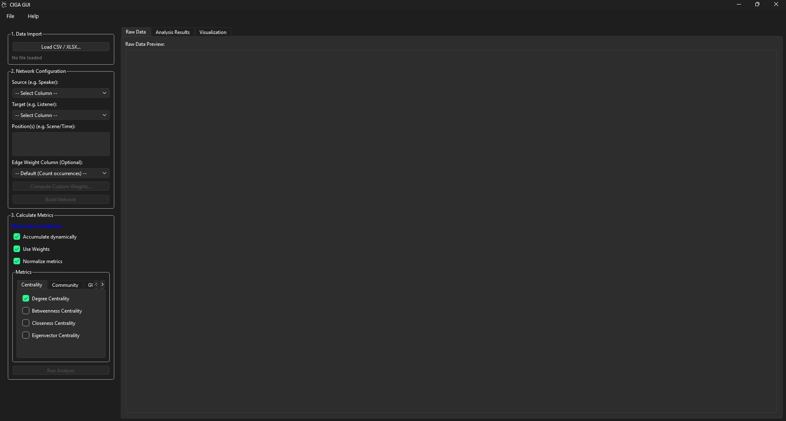

# CIGA GUI

**CIGA GUI** is a desktop application with a graphical interface designed for visualizing and analyzing Character Interaction Graphs. Provide your CSV annotation data to generate interactive network graphs and calculate various social network metrics like Centrality and Community detection.

*This tool is part of the [CIGA (Character Interaction Graph Analysis)](https://github.com/MediaCompLab/ciga-gui.git) project suite. It is recommended to use the [CIGA Annotator](../ciga-annotator/README.md) to generate compatible CSV data formats.*

## Features
- Load structured interaction data exported from CIGA Annotator.
- In-built static and temporal network visualizations.
- Integrated core social network algorithms (Degree Centrality, Betweenness, Closeness, Modularity, etc.).
- Easily export analyzed metrics results and visualizations.


**Screen shot**



## Installation & Usage (Two Options)

### Option 1: Portable Release (For Standard Users)
If you don't want to configure Python environments, simply download the pre-packaged release:
1. Go to the **Releases** page of this repository.
2. Download the `CIGA-GUI-Windows-Portable.zip` file.
3. Extract the ZIP file anywhere on your computer.
4. Double-click `CIGA-GUI.exe` inside the extracted folder to run the application immediately. No installation or Python environment is required!

### Option 2: Run from Source (For Developers & Researchers)
If you already have Python installed and prefer running from the source code:

1. **Clone the repository:**
   ```bash
   git clone https://github.com/MediaCompLab/ciga-gui.git
   cd ciga-gui
   ```

2. **Install Dependencies:**
   We recommend using a Python virtual environment or Conda environment:
   ```bash
   pip install -r requirements.txt
   ```

3. **Run the Application:**
   ```bash
   python src/main.py
   ```

## Build Windows App (For Developers)

To build the distributable Windows portable package, run:

```bash
python build.py
```

After the build completes, a directory will be generated at `dist/CIGA-GUI`.
You can ZIP this entire directory and distribute it to users. 

*Note: The build uses PyInstaller in directory mode (`--onedir`). We intentionally avoid `--onefile` mode because compressing heavy ML libraries (like PyTorch) into a single executable results in extremely slow startup times for end-users. The distributed directory ensures the application launches instantly.*
