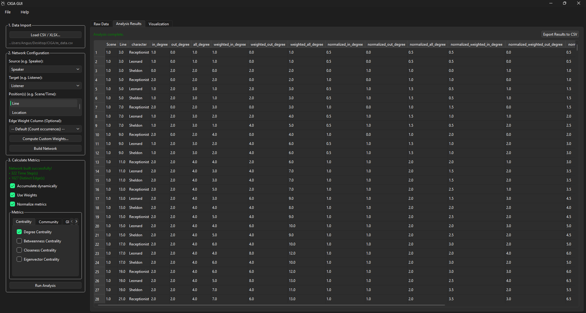
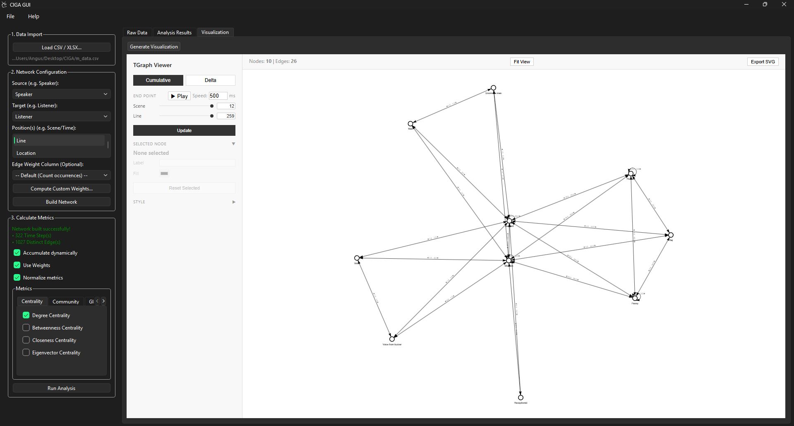

# CIGA GUI

**CIGA GUI** is a desktop application with a graphical interface designed for visualizing and analyzing Character Interaction Graphs. Provide your CSV annotation data to generate interactive network graphs and calculate various social network metrics like Centrality and Community detection.

*This tool is part of the [CIGA (Character Interaction Graph Analysis)](https://github.com/MediaCompLab/ciga.git) project suite. It is recommended to use the [CIGA Annotator](../ciga-annotator/README.md) to generate compatible CSV data formats.*

## Features
- Load structured interaction data exported from CIGA Annotator.
- In-built static and temporal network visualizations.
- Integrated core social network algorithms (Degree Centrality, Betweenness, Closeness, Modularity, etc.).
- Easily export analyzed metrics results and visualizations.

**Screen shot**




## Installation & Run

1. **Install Dependencies**  
   We recommend running this in a Python virtual environment:
   ```bash
   pip install -r requirements.txt
   ```

2. **Run the Application**  
   ```bash
   python src/main.py
   ```
